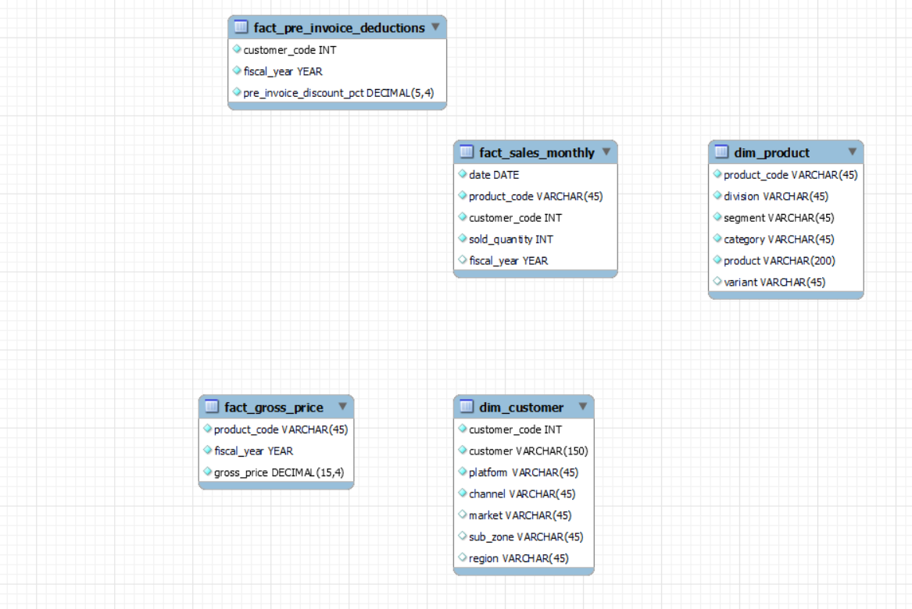

# Consumer Goods Ad Hoc Analysis | SQL

## Project Overview

This project focuses on answering business questions for AtliQ Hardware, a fictional consumer goods and computer hardware business with operations across multiple markets.

The objective was to use SQL to explore sales, products, customers, pricing, discounts, and distribution channels, then turn the results into insights that could support business decisions.

The project was completed as part of the **Codebasics Resume Project Challenge**. It includes 10 ad hoc business requests, the SQL queries used to answer them, and a presentation summarizing the results.

## Business Context

AtliQ Hardware operates across different markets and sells a broad range of products through multiple customer and distribution channels. Understanding its performance requires looking beyond overall sales figures.

Business teams may need answers to questions such as:

- Which markets does a particular customer operate in?
- How has the product portfolio changed over time?
- Which products and segments have the widest range?
- Which customers receive the highest pre-invoice discounts?
- How do sales vary by month and fiscal quarter?
- Which channels contribute the most to gross sales?
- Which products sell the highest quantities within each division?

This project addresses these questions using SQL queries against a relational database.

## Tools & Skills

- **SQL:** MySQL
- **Data analysis:** Aggregation, filtering, sorting, and year-over-year comparisons
- **SQL techniques:** Joins, CTEs, subqueries, conditional logic, aggregate functions, and window functions
- **Business analysis:** Product performance, customer discounts, sales trends, and channel contribution

## Database Structure

The database contains five tables. The two dimension tables provide customer and product details, while the fact tables store monthly sales, gross pricing, and pre-invoice discount information.

| Table | Type | Key information |
|---|---|---|
| `fact_sales_monthly` | Fact | Date, product code, customer code, quantity sold, fiscal year |
| `fact_gross_price` | Fact | Product code, fiscal year, gross price |
| `fact_pre_invoice_deductions` | Fact | Customer code, fiscal year, pre-invoice discount percentage |
| `dim_customer` | Dimension | Customer, platform, channel, market, sub-zone, region |
| `dim_product` | Dimension | Product, variant, category, segment, division |

### Data Model

The analysis uses these tables to connect sales records with product and customer attributes, and to evaluate pricing and discount information.

## Business Requests & SQL Analysis

The project covers 10 ad hoc requests, each solved using SQL.

| # | Business question | Analysis focus |
|---:|---|---|
| 1 | In which APAC markets does AtliQ Exclusive operate? | Customer and regional filtering |
| 2 | What was the percentage increase in unique products in 2021 compared with 2020? | Distinct counts and year-over-year growth |
| 3 | How many unique products belong to each segment? | Aggregation and ranking |
| 4 | Which segments experienced the largest increase in unique products? | CTEs, joins, and year-over-year comparison |
| 5 | Which products have the highest and lowest manufacturing costs? | Joins, subqueries, and sorting |
| 6 | Which five customers received the highest average pre-invoice discounts in India in FY2021? | Aggregation, filtering, and ranking |
| 7 | What was the monthly gross sales trend for AtliQ Exclusive? | Joins, aggregation, and time-based analysis |
| 8 | Which quarter had the highest total quantity sold in FY2020? | Conditional logic and aggregation |
| 9 | Which channel contributed the most to gross sales in FY2021, and what was its share? | CTEs, aggregation, and percentage calculation |
| 10 | Which three products had the highest quantity sold in each division in FY2021? | CTEs and window functions |

## Key Findings

The analysis produced several useful observations:

- **Product portfolio expansion:** The number of unique products increased from 245 in FY2020 to 334 in FY2021, a rise of 36.33%.
- **Accessories expansion:** The Accessories segment added 34 unique products, the largest absolute increase among the segments shown.
- **Manufacturing cost variation:** The highest-cost product in the analysis was AQ HOME Allin1 Gen 2, at approximately 240.54, compared with approximately 0.89 for AQ Master wired x1 Ms.
- **Customer discounts:** Among the five customers receiving the highest average pre-invoice discounts in India in FY2021, Flipkart ranked first at approximately 30.83%.
- **Channel concentration:** Retailer contributed 73.22% of FY2021 gross sales, followed by Direct at 15.48% and Distributor at 11.31%.
- **Sales seasonality:** The FY2020 quarterly analysis identified Q1 (September–November) as the highest-volume quarter.

These findings describe the results in the supplied analysis; they are not forecasts or recommendations based on additional external data.

## Project Files

### SQL Queries

Each file contains the SQL query for the corresponding business request.

| Query | File |
|---:|---|
| 1 | [Query_1.sql](SQL_queries/Query_1.sql) |
| 2 | [Query_2.sql](Query_2.sql) |
| 3 | [Query_3.sql](Query_3.sql) |
| 4 | [Query_4.sql](Query_4.sql) |
| 5 | [Query_5.sql](Query_5.sql) |
| 6 | [Query_6.sql](Query_6.sql) |
| 7 | [Query_7.sql](Query_7.sql) |
| 8 | [Query_8.sql](Query_8.sql) |
| 9 | [Query_9.sql](Query_9.sql) |
| 10 | [Query_10.sql](Query_10.sql) |

### Presentation

The presentation includes the business requests, SQL queries, query results, and key insights.

[**View the Consumer Goods Ad Hoc Analysis presentation (PDF)**](Consumer_goods_ad_hoc.pdf)

## What I Practised

This project gave me practical experience translating business questions into SQL queries, working across related tables, comparing performance across fiscal years, and presenting query results in a business-friendly format.

It also helped me practise choosing appropriate SQL techniques for different analytical problems rather than relying on a single query pattern.

## Project Challenge

Completed as part of the [Codebasics Resume Project Challenge – Consumer Goods](https://codebasics.io/challenges/codebasics-resume-project-challenge/7).
